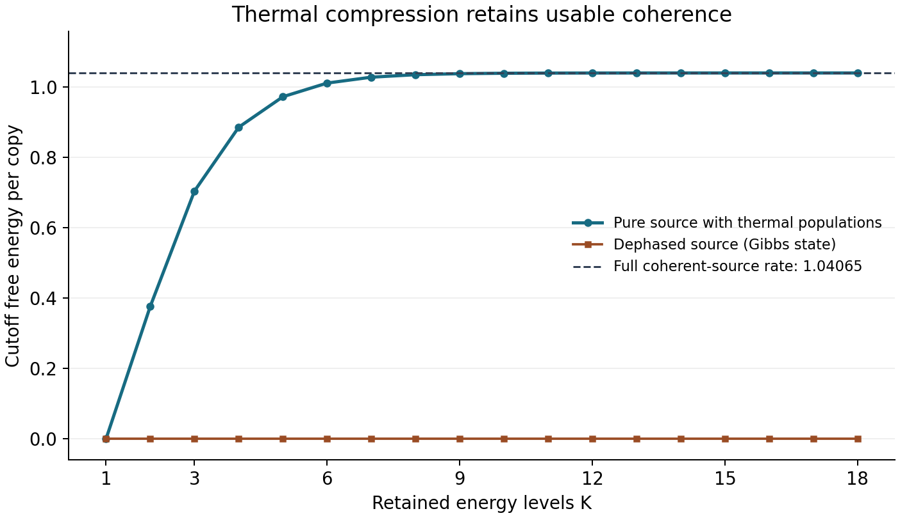

# Oscillator sources, coherence, and slow tails

The harmonic oscillator makes the main guarantee concrete. Every fixed state with finite mean energy is covered, including coherent superpositions with population tails slower than any power-law envelope of exponent strictly larger than two. No energy bound or tail estimate is supplied to the processor.

The construction is pointwise in the unknown source. The last section shows that a common finite-sample guarantee is impossible even if a finite upper bound on mean energy is known.

## 1. Finite mean energy gives a finite thermodynamic rate

Let

```math
H=\Delta N,
\qquad
N=\sum_{j=0}^{\infty}j|j\rangle\langle j|,
\qquad
q=e^{-\beta\Delta}.
\qquad\text{(O1)}
```

Then

```math
Z=\frac{1}{1-q},
\qquad
\tau=(1-q)\sum_{j=0}^{\infty}q^j|j\rangle\langle j|.
\qquad\text{(O2)}
```

If $`E=\mathrm{Tr}(H\rho)\lt \infty`$, the source entropy is finite. One way to see this without assuming entropy continuity is to replace the tail above level $`L-1`$ by the ground state. The resulting finite-dimensional state $`\widetilde\rho_L`$ has energy at most $`E`$, converges to $`\rho`$ in trace norm, and obeys the finite-dimensional Gibbs variational bound

```math
S(\widetilde\rho_L)
\le\beta' E+\ln Z(\beta')
\qquad (\beta'>0).
\qquad\text{(O3)}
```

Lower semicontinuity of entropy gives the same bound for $`S(\rho)`$. Optimizing over $`\beta'>0`$ yields

```math
S(\rho)\le g(E/\Delta),
\qquad
g(x)=(x+1)\ln(x+1)-x\ln x.
\qquad\text{(O4)}
```

The value at $`x=0`$ is understood by continuity. Energy and entropy can therefore be separated safely:

```math
f(\rho)=\frac{D(\rho\Vert\tau)}{\beta}
=E-\frac{S(\rho)}{\beta}+\frac{\ln Z}{\beta}.
\qquad\text{(O5)}
```

The [main theorem](model_theorem.md) attains this rate for every fixed finite-energy state, with all training specimens counted in the input block. For a more general Hamiltonian, finite relative entropy is the primitive assumption; equation (O5) is not used when its separate terms could be infinite.

## 2. The cutoff preserves coherence inside its retained sector

For $`\Pi_K=\sum_{j=0}^{K-1}|j\rangle\langle j|`$, the exact thermal cutoff is

```math
\rho_K
=\Pi_K\rho\Pi_K
+\mathrm{Tr}[(I-\Pi_K)\rho]\,\tau_K,
\qquad
\tau_K=\frac{\Pi_K\tau\Pi_K}{1-q^K}.
\qquad\text{(O6)}
```

It replaces the high-energy sector by a Gibbs state. It preserves all matrix elements between retained energy levels. Its [conditional-swap dilation](thermal_cutoff.md) establishes that this is an exact thermal operation.

Consider the pure geometric superposition

```math
|\psi_a\rangle
=\sqrt{1-a}\sum_{j=0}^{\infty}a^{j/2}|j\rangle,
\qquad 0\lt a\lt 1.
\qquad\text{(O7)}
```

Its mean energy is $`\Delta a/(1-a)`$ and its entropy is zero, so

```math
f(|\psi_a\rangle\langle\psi_a|)
=\frac{\Delta a}{1-a}+\frac{\ln Z}{\beta}.
\qquad\text{(O8)}
```

For finite $`K`$, let $`v_K`$ be the unnormalized vector consisting of the first $`K`$ amplitudes in (O7). The compressed state is exactly

```math
\rho_K=v_Kv_K^\dagger+a^K\tau_K.
\qquad\text{(O9)}
```

This gives a direct finite-matrix check of the convergence of $`f_K=D(\rho_K\Vert\tau_K)/\beta`$.

When $`a=q`$, the energy populations of the pure state are exactly thermal. Dephasing it produces $`\tau`$, whose extractable free energy is zero. Keeping the coherence gives instead

```math
f(|\psi_q\rangle\langle\psi_q|)
=\frac{S(\tau)}{\beta}>0.
\qquad\text{(O10)}
```

The cutoff maps the dephased state to $`\tau_K`$ at every $`K`$, while the coherent source retains a positive asymptotic rate. Collective energy-conserving processing can use coherence within the many-copy energy sectors; the construction does not require a supplied phase reference.



The figure uses $`\beta=\Delta=1`$ and $`a=e^{-1}`$. The coherent-source limit is approximately $`1.04065`$ energy units per copy. The [verification script](../verification/README.md) generates the data directly from (O9). It illustrates the cutoff argument; it does not numerically simulate the exponentially large extraction bath.

## 3. A finite-energy source outside every stronger power-law tail class

Define probabilities supported on $`j\ge2`$ by

```math
p_j=\frac{c}{j^2\ln^2(j+1)},
\qquad
c^{-1}=\sum_{j=2}^{\infty}\frac{1}{j^2\ln^2(j+1)},
\qquad\text{(O11)}
```

and take the pure state $`|\psi\rangle=\sum_{j\ge2}\sqrt{p_j}|j\rangle`$. Its mean energy is finite because

```math
\sum_{j=2}^{\infty} j p_j
=c\sum_{j=2}^{\infty}\frac{1}{j\ln^2(j+1)}\lt \infty.
\qquad\text{(O12)}
```

For every $`\varepsilon>0`$, the sequence $`p_j`$ is not $`O(j^{-(2+\varepsilon)})`$: the ratio is proportional to $`j^\varepsilon/\ln^2(j+1)`$ and diverges. This example is therefore outside the stronger polynomial-tail hypothesis in Watanabe and Takagi's 2026 finite-candidate result, while the present theorem applies to it without identifying it in advance. The [related-work comparison](../references/related_work.md) states the different source and output quantifiers precisely.

Its tail probability and discarded energy satisfy

```math
\epsilon_K:=\sum_{j\ge K}p_j
\sim\frac{c}{K\ln^2 K},
\qquad
E_K^{\mathrm{tail}}:=\Delta\sum_{j\ge K}jp_j
\sim\frac{c\Delta}{\ln K}.
\qquad\text{(O13)}
```

Write $`|\psi_K\rangle`$ for the normalized truncated vector. The compressed state is

```math
\rho_K=(1-\epsilon_K)|\psi_K\rangle\langle\psi_K|
+\epsilon_K\tau_K.
\qquad\text{(O14)}
```

The entropy of a mixture is at most the classical mixing entropy plus the average component entropy. Thus

```math
S(\rho_K)
\le h_2(\epsilon_K)+\epsilon_K S(\tau_K)
=O\!\left(\frac{1}{K\ln K}\right),
\qquad\text{(O15)}
```

where $`S(\tau_K)\le S(\tau)\lt \infty`$. With $`E_{\tau_K}=\mathrm{Tr}(H\tau_K)`$ and $`Z_K=\mathrm{Tr}(\Pi_K e^{-\beta H})`$, direct subtraction gives

```math
f(\rho)-f_K(\rho)
=E_K^{\mathrm{tail}}-\epsilon_K E_{\tau_K}
+\frac{S(\rho_K)}{\beta}
+\frac{\ln(Z/Z_K)}{\beta}
\sim\frac{c\Delta}{\ln K}.
\qquad\text{(O16)}
```

All other terms are smaller than $`1/\ln K`$. The achievable work rate still converges to the full free energy, but the approximation in cutoff dimension can be very slow. The universal stage schedule is chosen independently of this tail and supplies no source-independent rate for the remaining cutoff error.

## 4. Why an energy bound does not give a uniform sample guarantee

Fix any $`E_*>0`$ and consider the entire class of oscillator states with mean energy at most $`E_*`$. For sufficiently large integer $`R`$, let

```math
\rho_0=|0\rangle\langle0|,
\qquad
\rho_R=(1-\epsilon_R)|0\rangle\langle0|
+\epsilon_R|R\rangle\langle R|,
\qquad
\epsilon_R=\frac{E_*}{\Delta R}.
\qquad\text{(O17)}
```

The mean energy of $`\rho_R`$ is $`E_*`$. Its free-energy rate differs from that of the ground state by

```math
f(\rho_R)-f(\rho_0)
=E_*-\frac{h_2(\epsilon_R)}{\beta}
\longrightarrow E_*.
\qquad\text{(O18)}
```

Nevertheless, for every fixed number of copies $`n`$, the trace distance is

```math
\frac12\|\rho_R^{\otimes n}-\rho_0^{\otimes n}\|_1
=1-(1-\epsilon_R)^n
\le n\epsilon_R
\longrightarrow0
\quad(R\to\infty).
\qquad\text{(O19)}
```

Every quantum channel followed by a battery-energy measurement contracts this distance. For large enough $`R`$, the two intervals of radius $`E_*/4`$ around the free-energy rates are disjoint. If $`e_0`$ and $`e_R`$ are the corresponding probabilities of estimation error at least $`E_*/4`$, disjointness and total-variation distance give

```math
e_0+e_R\ge1-n\epsilon_R.
\qquad\text{(O20)}
```

Taking $`R\to\infty`$ at fixed $`n`$ proves, for every fixed processor and every $`n`$,

```math
\sup_{\rho:\,\mathrm{Tr}(H\rho)\le E_*}
\Pr_\rho\!\left[
\left|\frac{X_n}{n}-f(\rho)\right|\ge\frac{E_*}{4}
\right]
\ge\frac12.
\qquad\text{(O21)}
```

This is a statistical two-source obstruction, so it holds even if the processor is more general than a thermal operation and is told the energy bound. Rare high-energy events can carry a fixed amount of free energy while becoming arbitrarily hard to observe with a fixed sample size. A stronger tail condition can rule out this example; a mean-energy bound alone cannot.

The result does not contradict pointwise convergence. For each fixed $`\rho_R`$, its rare event eventually appears as $`n`$ grows. In (O21), the hard source may change with $`n`$.

## 5. Context and reproducibility

Gibbs variational bounds, entropy semicontinuity, and the contraction of trace distance are standard ingredients. The heavy-tail and rare-event constructions above make the scope of the present universal theorem explicit. See the [structured bibliography](../references/bibliography.bib), the [comparison with prior extraction results](../references/related_work.md), and the [finite verification notes](../verification/README.md).

Return to the [scientific reading route](README.md).
